# Reading Packets with Wireshark

## 1. Overview
This document demonstrates how Wireshark can be used to capture and examine common network protocols in a lab environment. The examples focus on identifying normal ICMP, DNS, DHCP, TCP, and ARP traffic and examining the packet fields useful for basic network troubleshooting.

## 2. Lab Environment

### 2.1 Systems Used

System |IP Address| Role
-------|----------|--------
Windows 11 client	| 192.168.10.100 |	Wireshark capture and test client
Windows Server 2022 |	192.168.10.10 |	AD domain controller, DNS and DHCP server
Windows Server 2022 |	192.168.10.11 |	Entra ID synchronization server
Ubuntu Server	| 192.168.20.10	| Web server in DMZ

The systems run as virtual machines in a VMware-based lab. VMware DHCP remains enabled on the virtual network, although the Windows Server at 192.168.10.10 provides DHCP for the lab configuration demonstrated here.

### 2.2 Capture Method

Specific Windows commands, such as ping, nslookup, and arp, were used to generate network traffic for each test.

For each capture:
1. Packet capture was started on the Windows 11 client's Ethernet0 interface.
2. The appropriate command or network activity was run to generate traffic.
3. The capture was stopped after the required traffic was recorded.
4. A Wireshark display filter was applied to isolate the relevant protocol.
5. The resulting packets and protocol details were examined.

Display filters were applied after capture rather than capture filters so that the complete packet exchange remained available for analysis.

## 3. ICMP — Echo Request and Reply

### 3.1 Generate ICMP Traffic

To generate ICMP traffic, we are using this command  `ping /n 192.168.10.10` . We are pinging the lab Domain Controller five times from the Wireshark client.

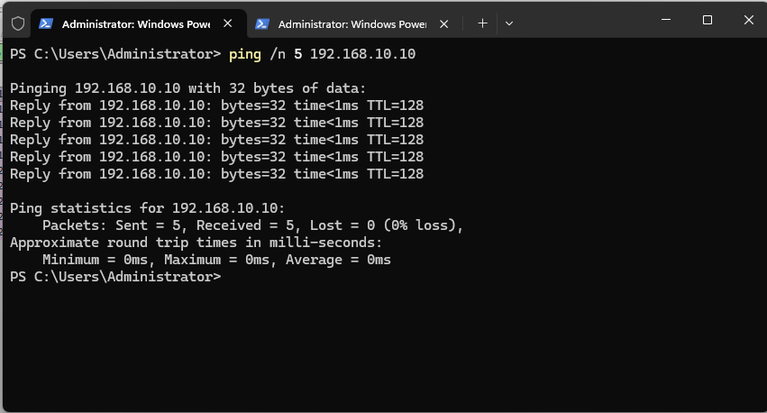  

### 3.2 Apply the ICMP Display Filter

As shown in the screenshot near the top left-hand corner, we applied the `icmp` filter.

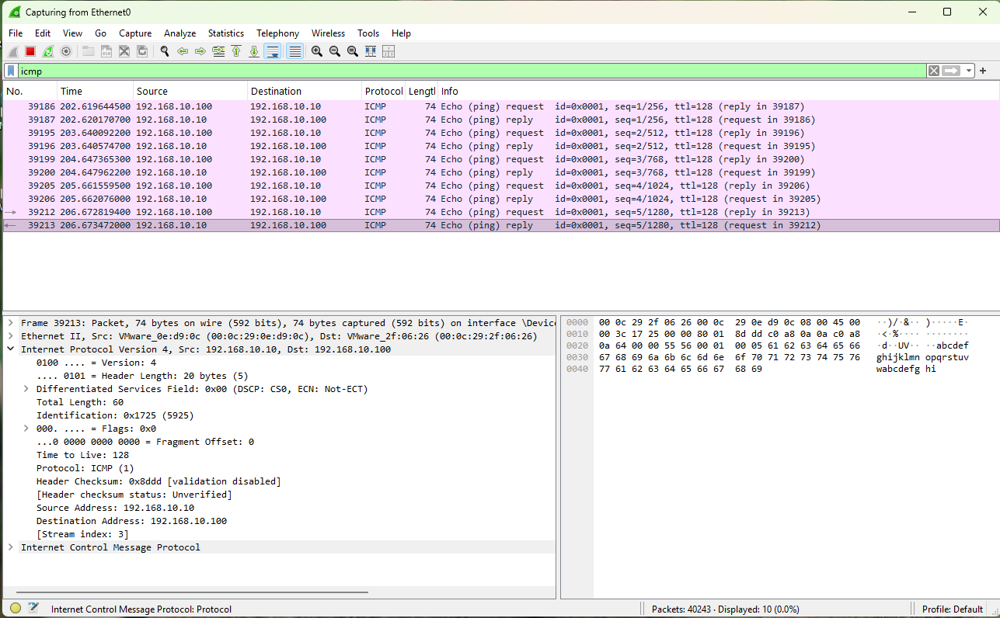  

### 3.3 Analyze the Packets

The Wireshark screenshot shows the following: 

- 192.168.10.100 (Source) sends an Echo Request to 192.168.10.10 (Destination).  
- 192.168.10.10 returns an Echo Reply.  
- Wireshark associates each request with its corresponding reply in the Info column. 
- Request/reply pairs demonstrate successful IP connectivity.  

Selecting an individual packet allows additional information to be examined in the Packet Details pane, including the IPv4 source and destination addresses and ICMP protocol information.

## 4. DNS — Name Resolution

### 4.1 Generate a DNS Query

To generate DNS traffic, we are using this command  `nslookup vanec1-w2022`. We are trying to resolve the IP address of the Entra ID synchronization server from the Wireshark client.

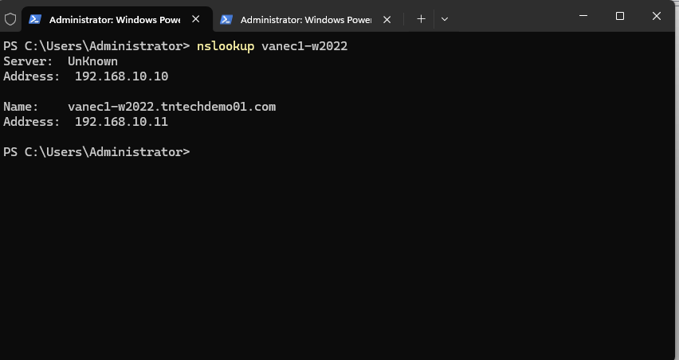  

### 4.2 Apply the DNS Display Filter

As shown in the screenshot near the top left-hand corner, we applied the `dns` filter.

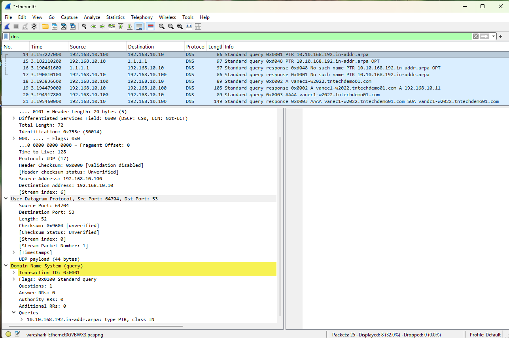  

### 4.3 Analyze the Query and Response

The `dns` display filter isolates DNS traffic in the capture.

Packets 18 and 19 show a successful DNS lookup between the Windows 11 client (192.168.10.100) and the DNS server (192.168.10.10).  
- Packet 18: The client sends an A record query for vanec1-w2022.tntechdemo01.com.  
- Packet 19: The DNS server responds with the IPv4 address 192.168.10.11.  
- The exchange demonstrates successful hostname-to-IPv4 address resolution using the lab DNS server.  
- The packet details also show that the DNS query is being sent using UDP destination port 53.  
- Additional DNS traffic may appear in the capture because the client can perform other DNS queries during the same period, including reverse lookups and IPv6 (AAAA) queries.  

## 5. DHCP — Address Configuration

### 5.1 Generate DHCP Traffic

To generate DHCP traffic, we are releasing and renewing the IP address on the Wireshark client using `ipconfig /release` and `ipconfig /renew`. 

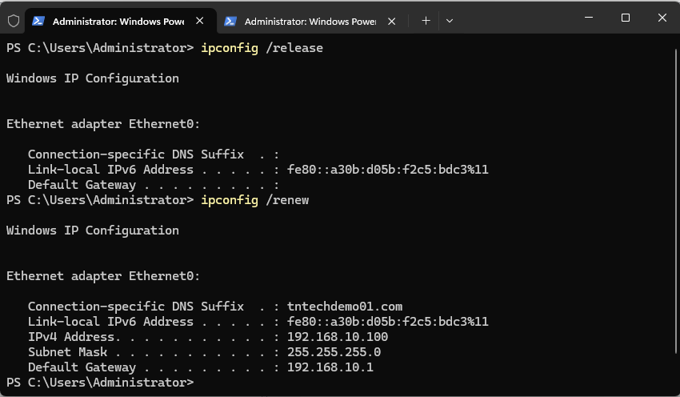  

### 5.2 Apply the DHCP Display Filter

As shown in the screenshot near the top left-hand corner, we applied the `dhcp` filter.  The DHCP server is running on the Domain Controller 192.168.10.10.  

- **DHCP Discover**  
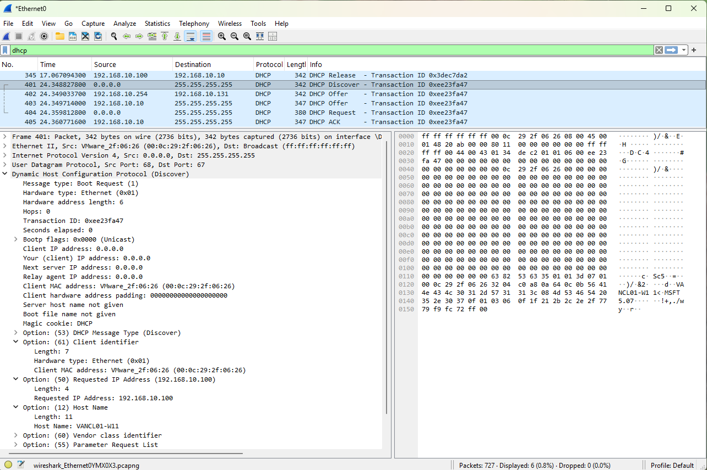

- **DHCP Offer**

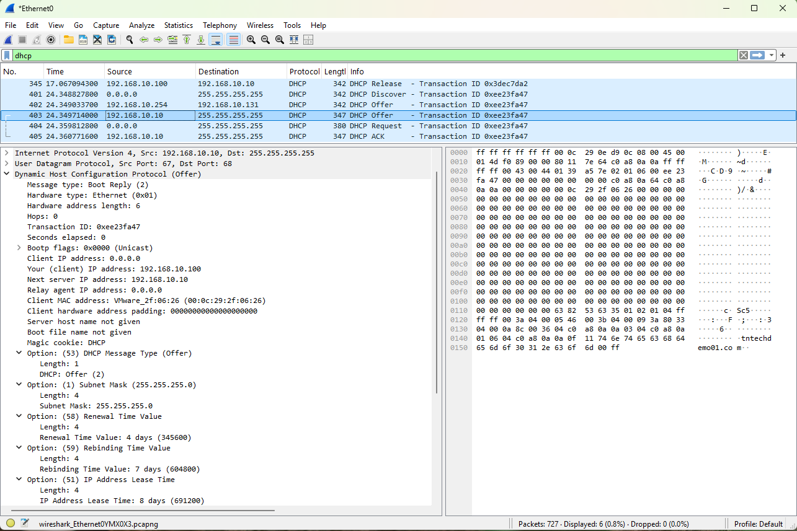  

- **DHCP Request**

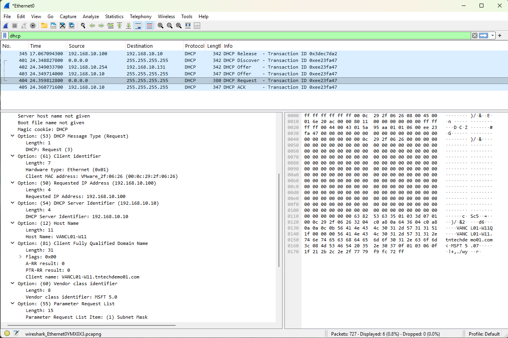  

- **DHCP ACK**

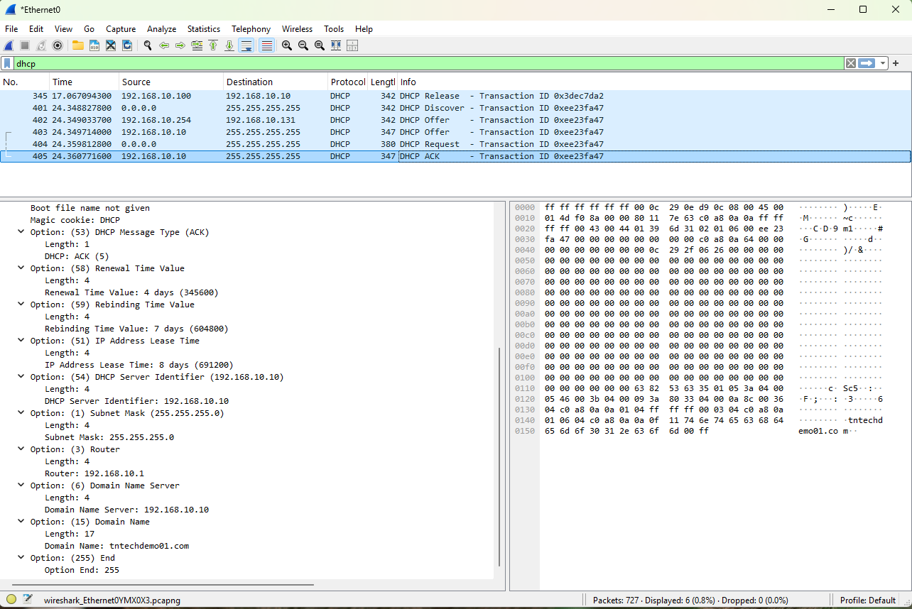  

### 5.3 Analyze the DHCP Exchange

The `dhcp` display filter isolates the DHCP exchange. After the existing lease was released, the client requested network configuration using the four-step DORA process:

- DHCP Discover — The client sends a broadcast from 0.0.0.0 to 255.255.255.255 to locate an available DHCP server. The client does not yet have an assigned IPv4 address.  
- DHCP Offer — The DHCP server (192.168.10.10) responds with an offer containing network configuration for the client, including the offered IP address.  
- DHCP Request — The client broadcasts a DHCP Request indicating that it wants to use the offered configuration. The packet identifies 192.168.10.10 as the selected DHCP server and requests 192.168.10.100 as the client address.  
- DHCP ACK — The DHCP server acknowledges the request and confirms the lease. The captured ACK includes configuration such as:  
  - IP address lease time: 8 days  
  - Subnet mask: 255.255.255.0  
  - Default gateway: 192.168.10.1  
  - DNS server: 192.168.10.10  
  - DNS domain: tntechdemo01.com  

The capture demonstrates how a client without an IPv4 configuration can use broadcast DHCP messages to locate a DHCP server, request an address, and receive the network settings required to communicate on the network.  

**Note:** The capture also contains an offer from 192.168.10.254, generated by the VMware DHCP service available on the virtual network. The client selects the Windows DHCP server at 192.168.10.10, as shown by the DHCP Request and ACK.

## 6. TCP — Connection Establishment

### 6.1 Generate TCP Traffic

To generate TCP traffic, we are enter URL `http://192.168.20.10` in the Web browser on the Wireshark client.  This takes us to a lab Ubuntu Web server running in the lab DMZ.  

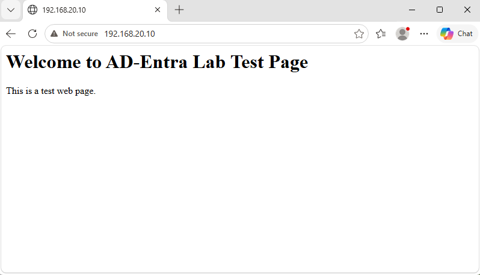  

### 6.2 Apply the TCP Display Filter

As shown in the screenshot near the top left-hand corner, we applied the filter `http && ip.addr==192.169.20.10`.  Wireshark shows additional TCP traffic on the Windows 11 client so we wanted to exclude that by using the filter shown.   

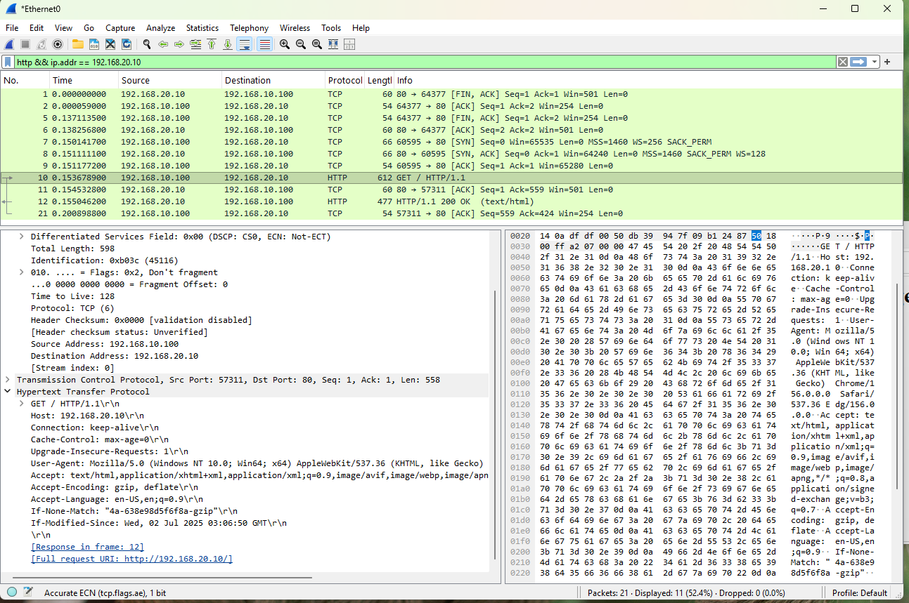  

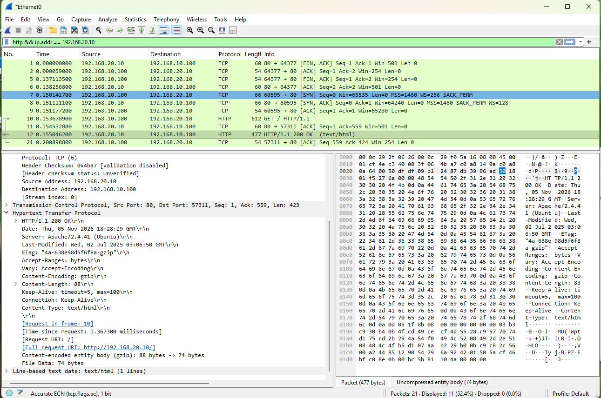  

### 6.3 Analyze the TCP Three-Way Handshake

The capture shows a TCP connection from the Windows 11 client (192.168.10.100) to the Ubuntu web server (192.168.20.10) on TCP port 80.  
- Packets 7–9 show the TCP three-way handshake used to establish the connection:  
- SYN — The client initiates the connection to TCP port 80.  
- SYN, ACK — The web server acknowledges the request and accepts the connection.  
- ACK — The client acknowledges the server's response, completing the connection.  
- After the connection is established, packet 10 contains an HTTP GET / request from the client.  
- Packet 12 contains the server's HTTP/1.1 200 OK response, indicating that the requested web page was successfully returned.  
- Because HTTP traffic on port 80 is unencrypted, Wireshark can display the HTTP request, response headers, and application data directly.  

## 7. ARP — Address Resolution

### 7.1 Generate ARP Traffic

To generate ARP traffic, we are using this command `arp -d * | ping 192.168.10.11`.  `arp -d *` clears the ARP cache to force the client to perform new ARP resolution. We want to get the MAC address of the Entra ID synchronization server.  

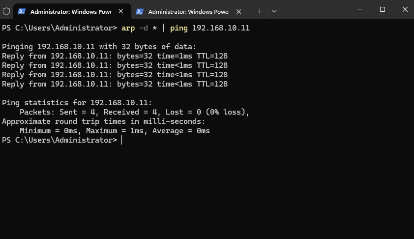 

### 7.2 Apply the ARP Display Filter

As shown in the screenshot near the top left-hand corner, we applied the `arp` filter.

- **ARP Request**  
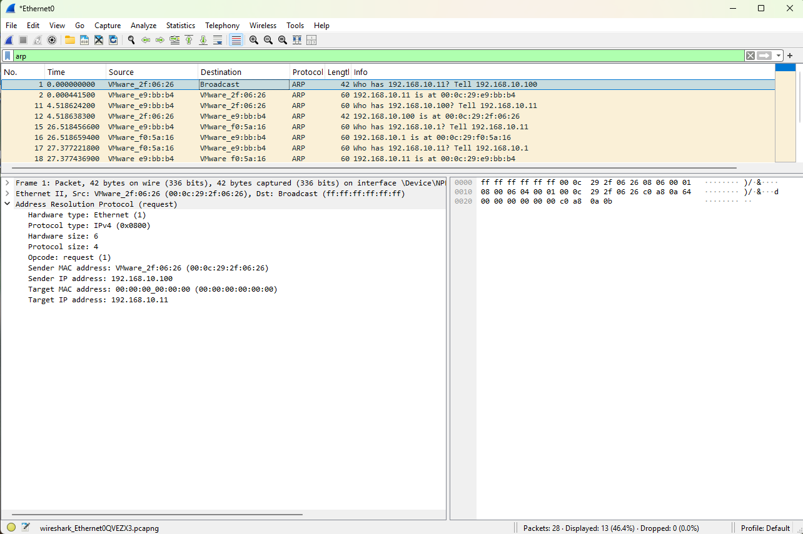

- **ARP Reply**  
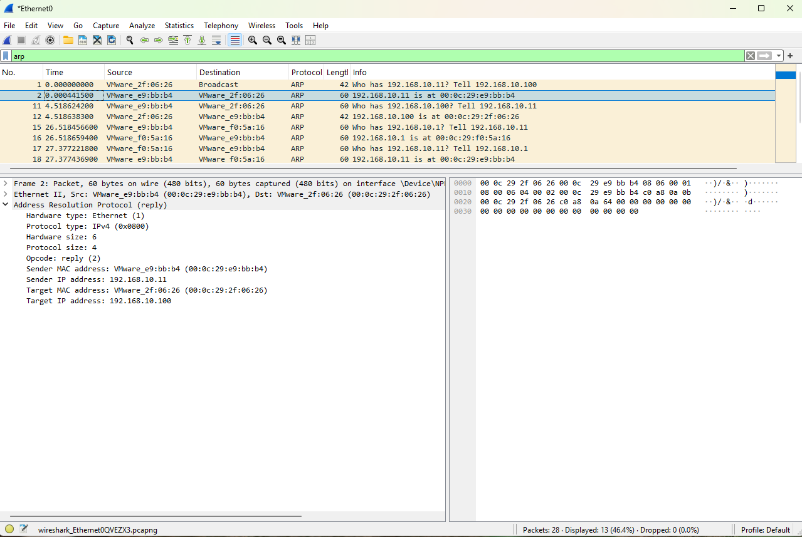 

### 7.3 Analyze the ARP Request and Reply

The arp display filter isolates Address Resolution Protocol traffic. After the ARP cache was cleared, network activity caused the client to resolve an IPv4 address to a MAC address.  
Packets 1 and 2 show the ARP exchange between the Windows 11 client (192.168.10.100) and the Entra ID synchronization server (192.168.10.11):  

- ARP Request — The client broadcasts "Who has 192.168.10.11?" because it does not yet know the MAC address associated with that IP address. The destination Ethernet address is the broadcast address ff:ff:ff:ff:ff:ff.  
- ARP Reply — 192.168.10.11 responds directly to the client and provides its MAC address: 00:0c:29:e9:bb:b4.  

The exchange demonstrates how ARP allows an IPv4 host to discover the Layer 2 MAC address associated with another device on the local network.  

## 8. Summary

These examples demonstrate how Wireshark can be used to capture, filter, and examine common network protocols in a lab environment.  

The packet captures show:  
- ICMP — Echo Request and Reply traffic used to verify IP connectivity.  
- DNS — A hostname query and response used to resolve a name to an IP address.  
- DHCP — The Discover, Offer, Request, and ACK (DORA) process used to obtain network configuration.  
- TCP/HTTP — TCP connection establishment followed by an HTTP request and successful response.  
- ARP — Resolution of a local IPv4 address to its corresponding MAC address.  

Together, these examples demonstrate how packet analysis can provide information beyond command output by showing the actual protocol exchanges occurring between systems.  
